  

### Technical Stack

  <strong>Languages &amp; Core Systems</strong> 
  
  
  
  
  
  

  <strong>Frameworks, AST &amp; Web Runtimes</strong> 
  
  
  
  
  
  

  <strong>Cloud, Edge &amp; Systems Tooling</strong> 
  
  
  
  
  
  

---

### Verified Engineering Showcase (Private Systems &amp; Case Studies)

> **Architecture Note:** Active client, hackathon, and proprietary repositories are maintained in private workspaces. Expand any system drawer below to inspect its architecture, data flow, and verification metrics.

<table>
  <tr>
    <td width="50%" valign="top">
      <h4>JusTrace &amp; DPDP Auditor</h4>
      <code>FastAPI</code> · <code>Semgrep AST</code> · <code>React 18</code> · <code>@xyflow/react</code>
      <ul>
        <li>Deterministic static code analyzer auditing repositories against India DPDP Act 2023 rules without black-box LLM variance.</li>
        <li>20+ custom Semgrep YAML AST rules feeding an interactive DAG dependency graph (<code>@xyflow/react</code> + <code>dagre</code>).</li>
      </ul>
      

        
Inspect System Architecture

        <pre><code>Source Repo ─▶ Semgrep YAML AST Engine ─▶ FastAPI Parser
                                                │
Interactive DAG (@xyflow/react + dagre) ◀───────┘</code></pre>
      

    </td>
    <td width="50%" valign="top">
      <h4>VeyLance Sentinel AI</h4>
      <code>2nd Runner-Up · HackBIOS 3.0 (70+ Teams)</code>
      <ul>
        <li>Real-time deepfake and biometric liveness inspection pipeline architected and shipped during a 24-hour sprint.</li>
        <li>Multi-frame facial artifact verification and latency-bounded inference pipeline built with a 4-engineer squad.</li>
      </ul>
      

        
Inspect System Architecture

        <pre><code>Live Frame Stream ─▶ Liveness &amp; Artifact Extractor
                                │
Real-Time Risk Verdict ◀────────┘</code></pre>
      

    </td>
  </tr>
  <tr>
    <td width="50%" valign="top">
      <h4>Orchvate Web &amp; Payroll Pipelines</h4>
      <code>Python</code> · <code>pandas</code> · <code>openpyxl</code> · <code>Azure SWA</code>
      <ul>
        <li>Automated three-point payroll reconciliation and monthly calendar rollover scripts covering <strong>112 main staff</strong> and <strong>39 OJT trainees</strong>.</li>
        <li>React 18 + Vite corporate frontend rebuild, WCAG accessibility tooling, and CVAT ground-truth dataset pipelines.</li>
      </ul>
      

        
Inspect System Architecture

        <pre><code>Raw Attendance Logs ─▶ Python 3-Point Validator
                             │
Verified Payroll XLSX ◀──────┘ (Zero-Drift Audit)</code></pre>
      

    </td>
    <td width="50%" valign="top">
      <h4>Edge Production &amp; Offline PWA Suite</h4>
      <code>Next.js 16</code> · <code>Cloudflare Pages</code> · <code>Service Workers</code>
      <ul>
        <li>Commercial Next.js 16 healthcare portal with technical SEO optimization and zero-downtime Cloudflare Pages edge delivery.</li>
        <li>5 offline-first PWAs (<em>TRACE, Rasoi Bhandar, ExpenseVault, MessMate, JalVitt</em>) using LocalStorage and custom DOM rendering.</li>
      </ul>
      

        
Inspect System Architecture

        <pre><code>Client Browser ─▶ Service Worker Cache ─▶ LocalStorage
                       │ (Offline-First)
Edge CDN (Cloudflare) ◀┘ (Zero Recurring DB Cost)</code></pre>
      

    </td>
  </tr>
</table>

  
<strong>Additional Systems: Red String (SIH) · Async Telegram Price Monitor · C++ Priority Engine</strong>

   
  <ul>
    <li><strong>Red String (Smart India Hackathon PS-26189):</strong> Criminal network entity-resolution and graph analytics platform with cryptographic chain-of-custody verification.</li>
    <li><strong>Async E-Commerce Price Monitor:</strong> Non-blocking Python runtime with SQLite local state persistence and instant Telegram alert dispatch.</li>
    <li><strong>Airline Boarding &amp; Priority Queue Engine:</strong> Deterministic C++ data structures and priority scheduling paired with a JavaFX interface.</li>
  </ul>

---

### Contribution Activity &amp; Coding Rhythm

  

<!-- cool-readme:start -->
<!-- Cards by github-cool-readme: https://github.com/pedrocatalao/github-cool-readme -->

<picture>
  <source media="(prefers-color-scheme: dark)" srcset="https://raw.githubusercontent.com/akhouriprakhar/akhouriprakhar/cards/weekly-dark.svg">
  
</picture>
<picture>
  <source media="(prefers-color-scheme: dark)" srcset="https://raw.githubusercontent.com/akhouriprakhar/akhouriprakhar/cards/streaks-dark.svg">
  
</picture>

<!-- cool-readme:end -->

---

### Connect

  
  &nbsp;&nbsp;
  
  &nbsp;&nbsp;
  
  &nbsp;&nbsp;
  

