  <picture>
    
  </picture>

---

### Technical Stack

  <picture>
    
  </picture>

---

### Verified Engineering Showcase

<table>
  <tr>
    <td width="50%" valign="top">
      <h4>JusTrace · DPDP Compliance Engine</h4>
      
<b>Statutory Privacy Lineage &amp; Automated AST Code Scanner</b>

      <ul>
        <li>Deterministic static code scanner evaluating 20 active India DPDP statutory rules across source codebases.</li>
        <li>Extracts data lifecycles using in-memory directed graphs (<code>dagre</code>, <code>@xyflow/react</code>) without black-box LLM hallucinations.</li>
        <li><b>Stack:</b> <code>FastAPI</code> · <code>Semgrep YAML Rules</code> · <code>React 18</code> · <code>Vite</code></li>
      </ul>
    </td>
    <td width="50%" valign="top">
      <h4>VeyLance Sentinel AI · 2nd Runner-Up</h4>
      
<b>Real-Time Deepfake &amp; Biometric Liveness Verification</b>

      <ul>
        <li>Real-time inspection system built during the 24-hour HackBIOS 3.0 hackathon by team TECHNICAL DEBT.</li>
        <li>Awarded 2nd Runner-Up out of 70+ competing engineering teams.</li>
        <li><b>Stack:</b> <code>Python</code> · <code>Computer Vision</code> · <code>Real-Time Streaming Web App</code></li>
      </ul>
    </td>
  </tr>
  <tr>
    <td width="50%" valign="top">
      <h4>Orchvate Web &amp; Data Engineering Pipelines</h4>
      
<b>Enterprise Staging &amp; Three-Point Payroll Automation</b>

      <ul>
        <li>Modernized enterprise web portal with Azure Static Web Apps CI/CD pipelines (<code>beta2.orchvate.com</code>).</li>
        <li>Automated monthly payroll reconciliation scripts eliminating manual verification across 151 staff and trainees.</li>
        <li><b>Stack:</b> <code>React 18</code> · <code>Azure Static Web Apps</code> · <code>Python (Pandas, OpenPyXL)</code></li>
      </ul>
    </td>
    <td width="50%" valign="top">
      <h4>Commercial Edge Deployments &amp; Offline PWAs</h4>
      
<b>Zero-Cold-Start Production Deployments &amp; Chapter Hubs</b>

      <ul>
        <li>Shipped commercial client site (<code>careathomeranchi.com</code>) using Next.js 16 on Cloudflare Pages.</li>
        <li>Engineered <code>awssstc.site</code> for AWS Student Community Day Bhilai with automated badge generation.</li>
        <li>Deployed 5 offline-first PWAs utilizing Service Workers and LocalStorage without recurring cloud database costs.</li>
        <li><b>Stack:</b> <code>Next.js 16</code> · <code>Cloudflare Pages</code> · <code>Service Workers</code> · <code>AWS</code></li>
      </ul>
    </td>
  </tr>
</table>

---

### Contribution Activity

  <picture>
    
  </picture>

---

### Development Rhythm

<!-- cool-readme:start -->

<picture>
  <source media="(prefers-color-scheme: dark)" srcset="https://raw.githubusercontent.com/akhouriprakhar/akhouriprakhar/cards/languages-dark.svg">
  
</picture>
<picture>
  <source media="(prefers-color-scheme: dark)" srcset="https://raw.githubusercontent.com/akhouriprakhar/akhouriprakhar/cards/weekly-dark.svg">
  
</picture>

<picture>
  <source media="(prefers-color-scheme: dark)" srcset="https://raw.githubusercontent.com/akhouriprakhar/akhouriprakhar/cards/summary-dark.svg">
  
</picture>
<picture>
  <source media="(prefers-color-scheme: dark)" srcset="https://raw.githubusercontent.com/akhouriprakhar/akhouriprakhar/cards/streaks-dark.svg">
  
</picture>

<!-- cool-readme:end -->

---

### Connect

  
  &nbsp;&nbsp;
  
  &nbsp;&nbsp;
  
  &nbsp;&nbsp;
  

