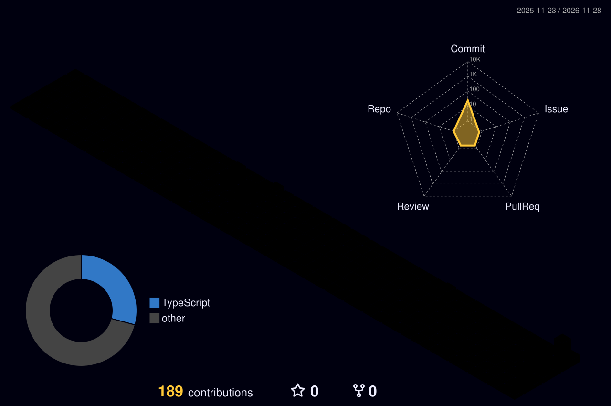

  <picture>
    
  </picture>

---

### Technical Stack

  
  
  
  
  
  
  
  
  
  
   
  
  
  
  
  
  
  
  
  
  

<!--
### Selected Projects
Projects segment reserved for curated showcase.
-->

---

### Contribution Activity

  <picture>
    
  </picture>

---

### Development Rhythm

<!-- cool-readme:start -->

<picture>
  <source media="(prefers-color-scheme: dark)" srcset="https://raw.githubusercontent.com/akhouriprakhar/akhouriprakhar/cards/languages-dark.svg">
  
</picture>
<picture>
  <source media="(prefers-color-scheme: dark)" srcset="https://raw.githubusercontent.com/akhouriprakhar/akhouriprakhar/cards/weekly-dark.svg">
  
</picture>

<picture>
  <source media="(prefers-color-scheme: dark)" srcset="https://raw.githubusercontent.com/akhouriprakhar/akhouriprakhar/cards/summary-dark.svg">
  
</picture>
<picture>
  <source media="(prefers-color-scheme: dark)" srcset="https://raw.githubusercontent.com/akhouriprakhar/akhouriprakhar/cards/streaks-dark.svg">
  
</picture>

<!-- cool-readme:end -->

---

### Connect

  
  &nbsp;&nbsp;
  
  &nbsp;&nbsp;
  
  &nbsp;&nbsp;
  

