  

  

---

<b>🧭 INTERACTIVE BREAKDOWN</b> tap each section to expand or collapse

  
🧰 <strong>Tech Stack &amp; Development Arsenal</strong>

   

| Domain | Technologies &amp; Tools |
| :--- | :--- |
| **Languages** | C · C++ · Python · Java · MySQL · HTML5 · CSS3 · JavaScript |
| **Engineering &amp; Core** | Data Structures &amp; Algorithms, Object-Oriented Programming (OOP) |
| **Development Tools** | Git · GitHub · VS Code · CMake · macOS &amp; Linux Terminal |
| **Current Focus** | Full-Stack Web Development, Cloud Infrastructure &amp; Task Automation |

  
🚀 <strong>Active Projects &amp; Ecosystem</strong>

   

* ⚙️ **Automation Utilities:** Custom scripts for streamlined workflow automation and productivity.
* 🌐 **Full-Stack Prototypes:** Modern web applications with clean, responsive user interfaces.
* 🧠 **Algorithmic Problem Solving:** Consistent C++ DSA problem solving with focus on performance.

---

<b>📊 REPO TELEMETRY &amp; CODING RHYTHM</b> real-time native cards · automatically updated

<!-- cool-readme:start -->
<!-- Cards by github-cool-readme: https://github.com/pedrocatalao/github-cool-readme -->

<picture>
  <source media="(prefers-color-scheme: dark)" srcset="https://raw.githubusercontent.com/akhouriprakhar/akhouriprakhar/cards/languages-dark.svg">
  
</picture>
<picture>
  <source media="(prefers-color-scheme: dark)" srcset="https://raw.githubusercontent.com/akhouriprakhar/akhouriprakhar/cards/weekly-dark.svg">
  
</picture>

<picture>
  <source media="(prefers-color-scheme: dark)" srcset="https://raw.githubusercontent.com/akhouriprakhar/akhouriprakhar/cards/summary-dark.svg">
  
</picture>
<picture>
  <source media="(prefers-color-scheme: dark)" srcset="https://raw.githubusercontent.com/akhouriprakhar/akhouriprakhar/cards/streaks-dark.svg">
  
</picture>

<!-- cool-readme:end -->

---

  <i>"Focusing on clarity, curiosity, and consistency in everything I ship."</i>

  
  &nbsp;
  
  &nbsp;
  

